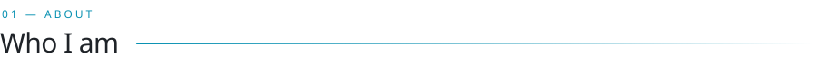
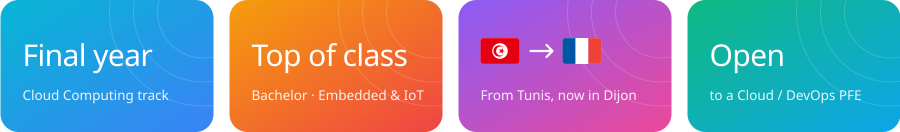
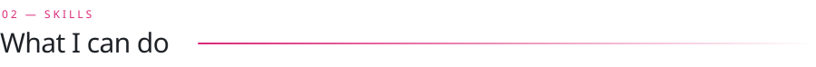
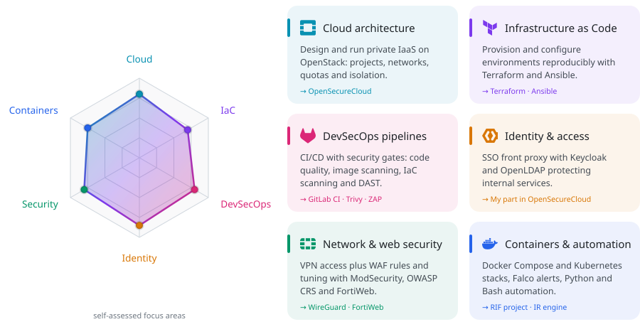
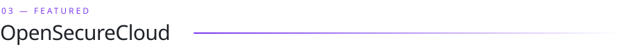
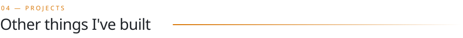
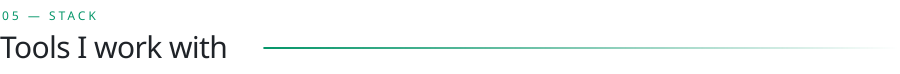

  &nbsp;
  &nbsp;
  

 

<picture>
  <source media="(prefers-color-scheme: dark)" srcset="assets/h-about-dark.svg">
  
</picture>

I'm from **Tunis, Tunisia**, a final-year **Cloud Computing** engineering student at **ESPRIT**, currently on exchange at **ESEO Dijon** (France).
I build secure, automated infrastructure, with a focus on **DevSecOps, private cloud, infrastructure as code** and **automated incident response**.

<picture>
  <source media="(prefers-color-scheme: dark)" srcset="assets/journey-dark.svg">
  
</picture>

 

<picture>
  <source media="(prefers-color-scheme: dark)" srcset="assets/h-skills-dark.svg">
  
</picture>

<picture>
  <source media="(prefers-color-scheme: dark)" srcset="assets/skills-dark.svg">
  
</picture>

 

<picture>
  <source media="(prefers-color-scheme: dark)" srcset="assets/h-featured-dark.svg">
  
</picture>

A secure private cloud on **OpenStack** with a fully open-source DevSecOps layer, built by a team of 4 engineers.
**My part:** the Keycloak / OpenLDAP authentication front proxy that sits in front of the WAF.

 

<picture>
  <source media="(prefers-color-scheme: dark)" srcset="assets/h-projects-dark.svg">
  
</picture>

  
  

  
  

 

<picture>
  <source media="(prefers-color-scheme: dark)" srcset="assets/h-stack-dark.svg">
  
</picture>

<picture>
  <source media="(prefers-color-scheme: dark)" srcset="assets/stack-dark.svg">
  
</picture>

 

