<a href="https://ghassen-kahia.github.io/">
  
</a>

  &nbsp;
  &nbsp;
  

 

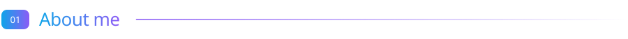

Final-year **Cloud Computing** engineering student at **ESPRIT** (Tunisia), currently on exchange at **ESEO Dijon** (France).
I build secure, automated infrastructure, with a focus on **DevSecOps, private cloud, infrastructure as code** and **automated incident response**.
I'm looking for a **Cloud / DevOps end-of-studies internship (PFE)** in France or internationally.


 

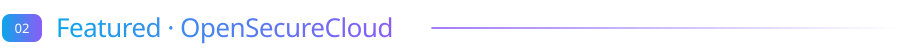

A secure private cloud on **OpenStack** with a fully open-source DevSecOps layer, built by a team of 4 engineers.
**My part:** the Keycloak / OpenLDAP authentication front proxy that sits in front of the WAF.

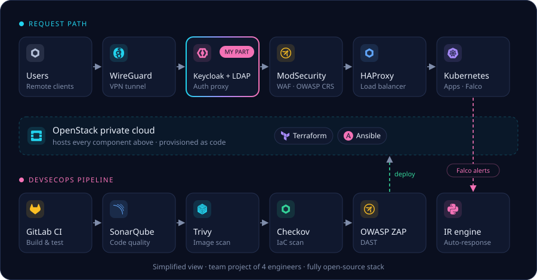

 

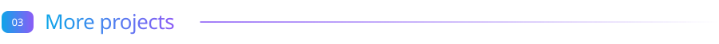

  <a href="https://github.com/Ghassen-kahia/RIF-PROJECT">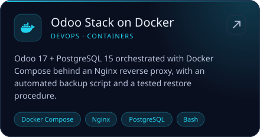</a>
  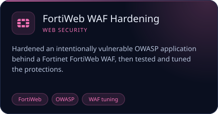

  
  <a href="https://github.com/Ghassen-kahia/Travolo-symfony"></a>

 

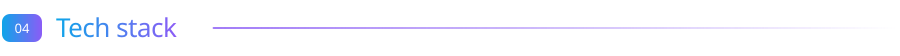

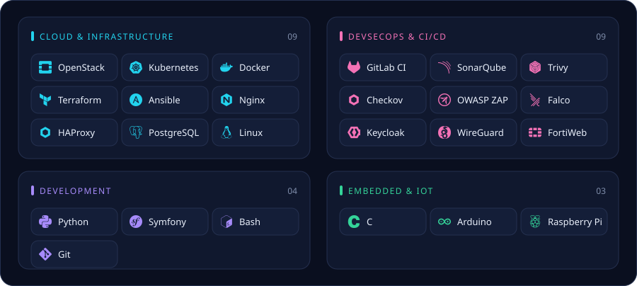

 

